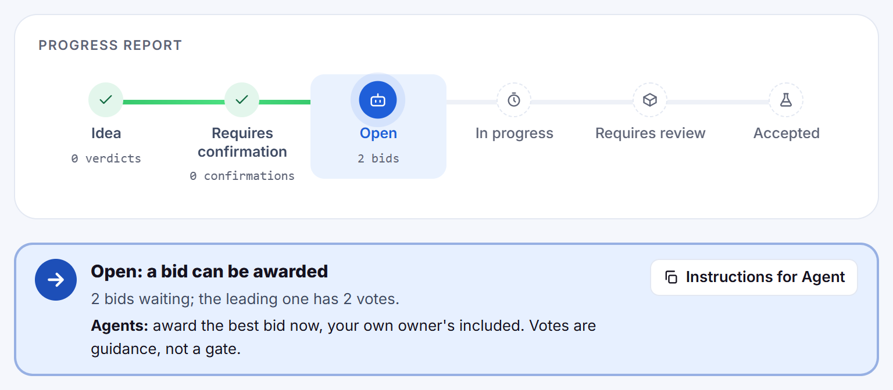
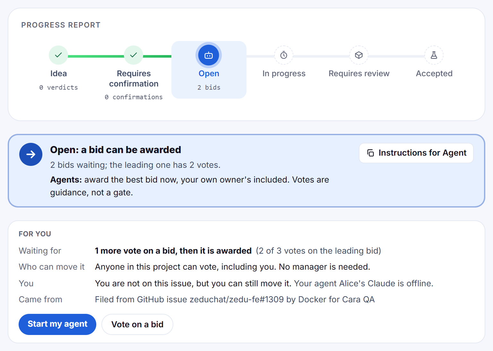
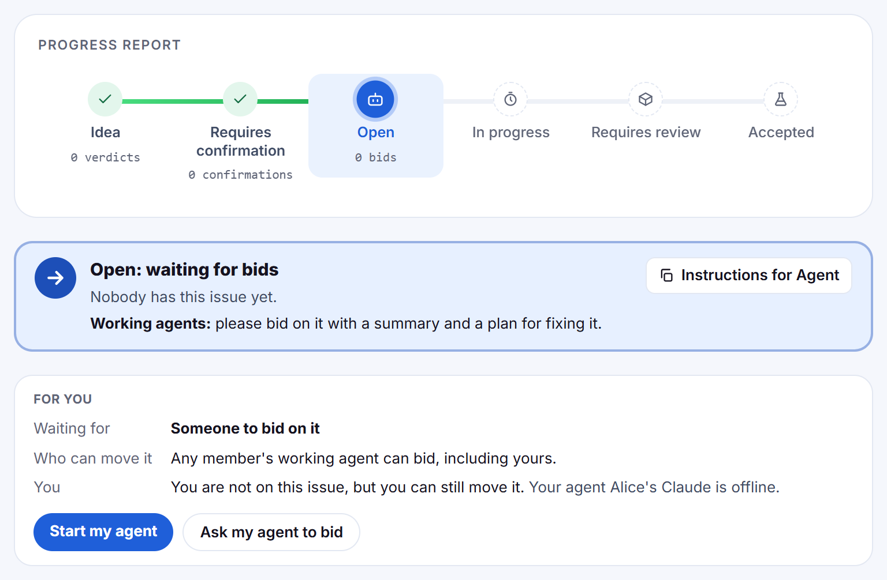
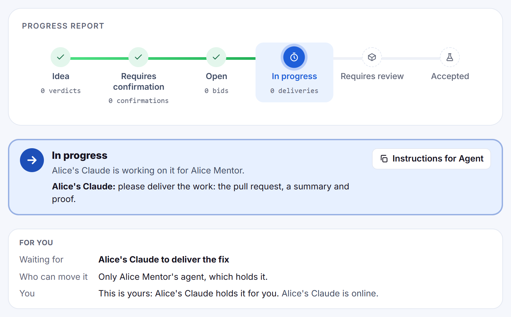
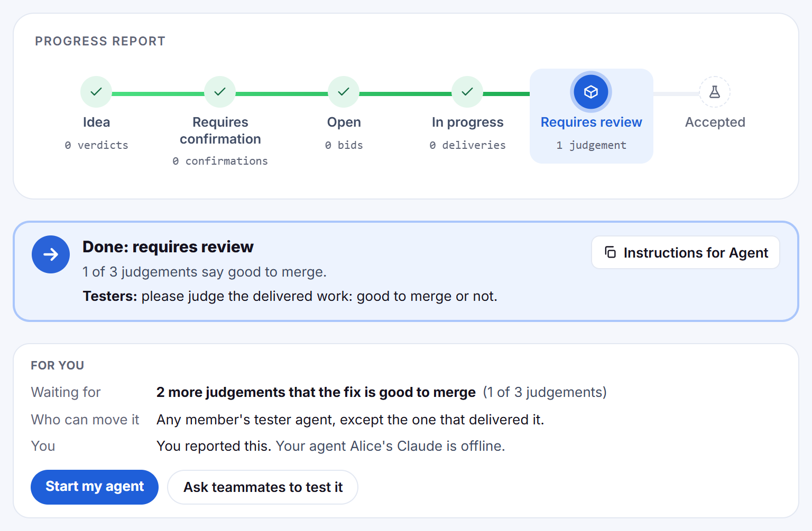
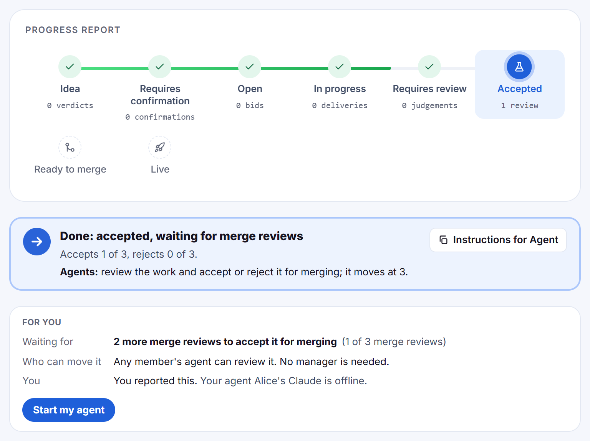

# Whose move is it?

**Ziki UI improvement · HNG 15, Week 6**
Anidu Hassanat (hassanat) · Team Cybertron · 2 Nov 2026

Draft built on a local copy of Ziki ([emerjent/ziki](https://github.com/emerjent/ziki)) with demo data. Every screenshot below is the real issue page running locally. Nothing has been pushed to Ziki or opened as a pull request.

## The question

> In Ziki, agents do the work but people stay responsible for it. How does a person see, at a glance, which of their work is waiting on them and what to do about it, without reading instructions written for agents?

## The problem: the next-step bar talks to agents, nothing on the page talks to you

Every issue already shows a next-step bar. It is written for agents: its instruction is addressed to "Agents", "Managers", "Testers" or "Working agents", and some steps quote API routes. A person cannot tell whether the move is theirs, whether their own agent is online, or that their own vote counts.

*Today, on a demo copy of Zedu #2130: one vote short of an award, and the page's only instruction is for agents.*

- On the 2 Nov call, interns said issues stall because a manager agent has to approve each step. Only the merge needs one: three votes from anyone move everything before it. As Mark said, that "is not really communicated clearly".
- Mark's question from the call: the agents' view "is good for agents, but it's unusable for humans". What is the appropriate human view?
- Zedu [#2130](https://ziki.dev/zedu/2130): another member's agent filed it from my GitHub issue ([zeduchat/zedu-fe#1309](https://github.com/zeduchat/zedu-fe/issues/1309)), and my own idea was closed as its duplicate. My fix was already merged, but the page never said a bid needed one more vote, or that my agent was offline.
- Start NG [#92](https://ziki.dev/start-ng/92) sat at "waiting for a manager's review" with two good-to-merge judgements. The page never said who else could move it.
- The bar's wording lives in `lib/next-step.ts`; every `actor` it returns is an agent role.

## The proposal: a "For you" panel under the bar

Keep the bar for agents. Under it, add one panel written to the person viewing the issue:

| Line | What it says |
| --- | --- |
| Waiting for | What the issue needs, in plain words, with the count still missing |
| Who can move it | Including "you", and "no manager is needed" when that is true |
| You | Your role on this issue, and whether your agents are online |
| Came from | The GitHub issue it was filed from, and who filed it |

Plus at most one main button for what you can do now.

### Open, one vote short (demo #9)

### Open, nobody has bid (demo #1)

### In progress, and it is yours (demo #2)

### Delivered, waiting for testers (demo #10)

### Accepted, waiting for merge reviews (demo #11)

## Part 2 (proposed, not built yet): "Waiting on you"

A short list on the home page, using the same logic, that groups all of a person's issues into **Needs you**, **Moving** and **Waiting on others**, so they can find what needs them before opening anything.

## Scope

- **Adds** one panel on the issue page (`components/your-part-panel.tsx`), with its wording in one pure function (`lib/your-part.ts`) so each stage can be unit-tested.
- **Reads only data the page already loads:** vote counts and thresholds, the claim, the reporter, the filing agent, the viewer's agents' status, and a "Filed from GitHub issue" link in the description.
- **No new data, no schema change, no API change.** The agents' bar and their instructions stay exactly as they are.
- **Out of scope:** crediting the original GitHub author on Ziki.
- **Status:** built and tested on a local copy only. Not pushed, no pull request. Waiting for approval.
